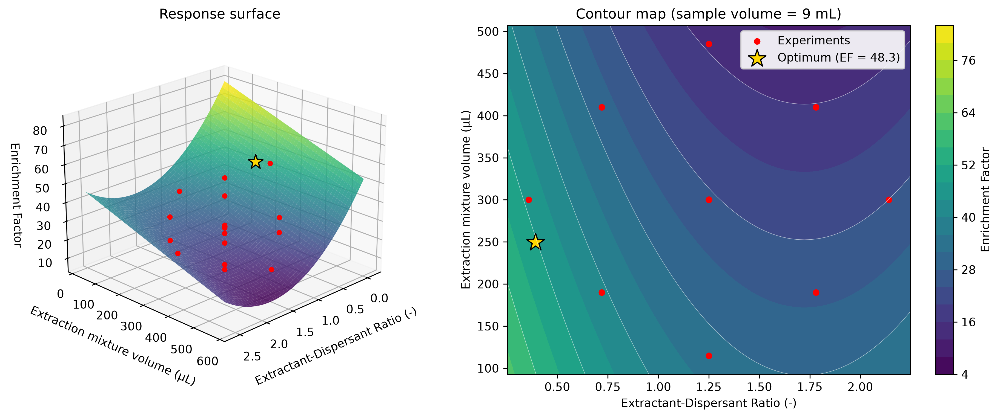
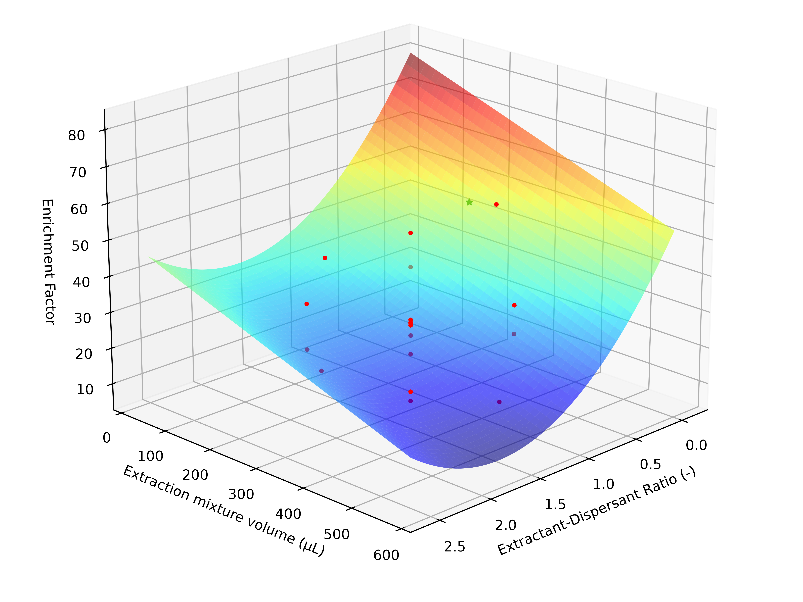
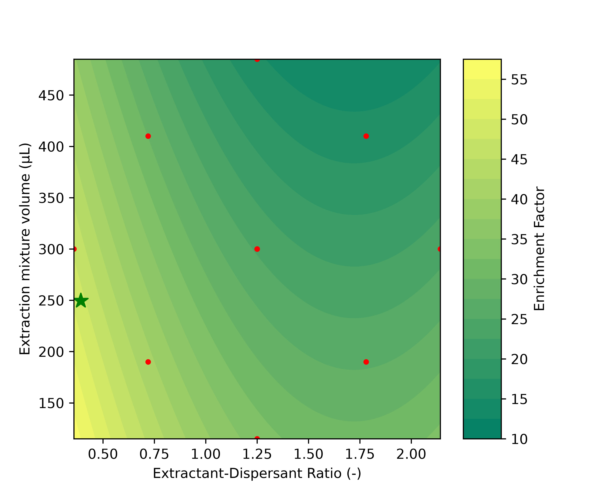
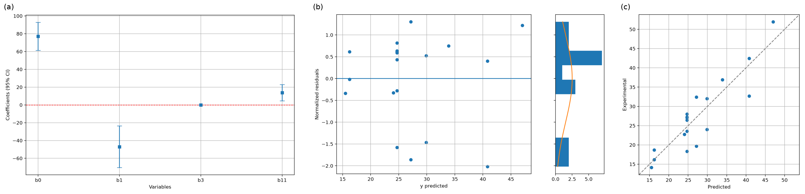
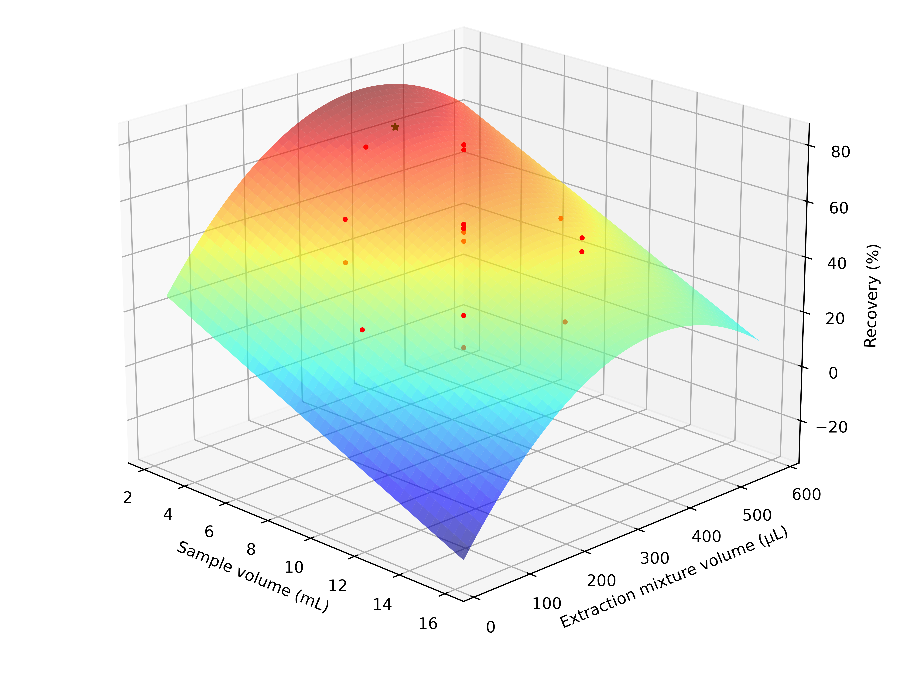

# rsm_design

**Response surface methodology in Python: fit quadratic models, optimise inside the region you actually measured, and plot publication-quality figures.**




## Why

Response surface methodology (RSM) is the workhorse for optimising analytical
methods: run a small designed set of experiments, fit a second-order model, and
read the optimum off the surface. `rsm_design` was built for a published
DLLME study (dispersive liquid-liquid microextraction with deep eutectic
solvents) and then generalised to any number of factors. It keeps the
statistical rigour (full `statsmodels` inference) and adds the guard rails that
are easy to forget: it checks that your design can actually estimate the model,
and it keeps the optimum inside the experimental region.

## Features

- N-factor quadratic OLS with full `statsmodels` inference (summary, ANOVA, confidence intervals).
- Term pruning: drop non-significant terms and refit with a single argument.
- Design-rank check that catches non-estimable models (for example a replicated 2^2 factorial) before they produce meaningless coefficients.
- Ellipsoid-constrained optimisation (SLSQP, multi-start) so the optimum stays within the validity region of a central composite design.
- Publication-quality diagnostic, surface and contour plots at 600+ DPI.
- One-way ANOVA + Tukey screening with box plots.
- A command-line interface: `rsm-design fit | optimize | plot`.

## Install

```bash
# Replace <user> with the GitHub account hosting the repository
pip install git+https://github.com/<user>/rsm_design      # placeholder URL

# Development install (editable, with pytest, black, ruff)
pip install -e ".[dev]"
```

Requires Python 3.10 or newer. See [docs/installation.md](docs/installation.md).

## Python quickstart

```python
from rsm_design import (
    load_experiments, fit_model, save_results, DesignRegion, optimize, surface_plot,
)

factors = ["Extractant-Dispersant Ratio", "Sample volume", "Extraction mixture volume"]
df = load_experiments(
    "data/dllme/experimental_results.xlsx",
    factors=factors, response="Enrichment Factor",
    sheet="RSM_3", header_row=1, skip_rows=2,
)
result = fit_model(df, factors, "Enrichment Factor", drop_terms=["b2", "b12", "b13", "b23", "b22", "b33"])
print(result.r_squared, result.adj_r_squared)
save_results(result, "results")                      # CSV, TXT summary, diagnostic PNGs

region = DesignRegion.from_data(df, factors)         # CCD validity ellipsoid
best = optimize(result.coefficients, region, maximize=True)
print(best.factors, best.response)                   # ratio 0.393, 9 mL, 249 uL -> EF 48.3
surface_plot(
    result.coefficients, factors, vary=[factors[0], factors[2]],
    fixed={"Sample volume": 9.0}, data=df, response="Enrichment Factor",
    optimum=best, folder="results",
)
```

The `drop_terms` list is the simplified enrichment-factor model of the paper; see
[docs/quickstart.md](docs/quickstart.md) for a complete walk-through.

## CLI quickstart

```powershell
rsm-design fit data\dllme\experimental_results.xlsx --sheet RSM_3 `
    --header-row 1 --skip-rows 2 `
    --factors "Extractant-Dispersant Ratio" "Sample volume" "Extraction mixture volume" `
    --response "Enrichment Factor" --drop b2 b12 b13 b23 b22 b33 --out results

rsm-design optimize data\dllme\experimental_results.xlsx --sheet RSM_3 `
    --header-row 1 --skip-rows 2 `
    --factors "Extractant-Dispersant Ratio" "Sample volume" "Extraction mixture volume" `
    --response "Enrichment Factor" --coefficients "results\EnrichmentFactor_model_params.csv"

rsm-design plot data\dllme\experimental_results.xlsx --sheet RSM_3 `
    --header-row 1 --skip-rows 2 `
    --factors "Extractant-Dispersant Ratio" "Sample volume" "Extraction mixture volume" `
    --response "Enrichment Factor" --coefficients "results\EnrichmentFactor_model_params.csv" `
    --vary "Extractant-Dispersant Ratio" "Extraction mixture volume" --fixed "Sample volume=9" `
    --kind both --optimum --out results
```

Full reference: [docs/cli.md](docs/cli.md).

## Example outputs

| Surface | Contour |
|---|---|
|  |  |

| Diagnostics | Recovery surface |
|---|---|
|  |  |

Optimum found for the enrichment factor (SLSQP, inside the CCD validity ellipsoid): extractant-dispersant ratio 0.393, sample volume 9 mL, extraction mixture volume 249 µL, predicted EF 48.3. It differs slightly from the 2024 scripts, whose optimizer stalled at the ellipsoid boundary; see [docs/methodology.md](docs/methodology.md).

## Reproducing the paper

The DLLME workbook and COSMO-RS screening data live in `data/dllme/`; the
scripts in `examples/dllme/` regenerate every figure and table.

```bash
python examples/dllme/fit_models.py
python examples/dllme/response_surfaces.py
python examples/dllme/univariate_screening.py
python examples/dllme/cosmo_screening.py
python examples/dllme/sigma_profile.py
```

Outputs go to `examples/dllme/results/`. Details in
[docs/examples_dllme.md](docs/examples_dllme.md). Note that optimum values can
differ slightly from those of the original 2024 scripts; see
[docs/methodology.md](docs/methodology.md).

## Project layout

```text
rsm_design/
  src/rsm_design/     model, data, optimize, plots, univariate, cli
  examples/dllme/     scripts that reproduce the paper, plus results/
  data/dllme/         public DLLME workbook and COSMO-RS data
  docs/               documentation (start at docs/index.md)
  tests/              pytest suite
  assets/             README images
  CODING_STYLE.md     coding conventions (Spanish)
  pyproject.toml
```

## Citation

If you use this software, please cite the paper it was built for:

> Sustainable framework to develop deep eutectic solvent-based DLLME
> methodologies using COSMO-RS and RSM: Application to PCB-77 in greywater.
> *Journal of Molecular Liquids*, 2024.
> DOI: [10.1016/j.molliq.2024.126790](https://doi.org/10.1016/j.molliq.2024.126790)

```bibtex
@article{rsm_design_paper_2024,
  title   = {Sustainable framework to develop deep eutectic solvent-based DLLME methodologies using COSMO-RS and RSM: Application to PCB-77 in greywater},
  journal = {Journal of Molecular Liquids},
  year    = {2024},
  doi     = {10.1016/j.molliq.2024.126790},
}
```

Note: the author list, volume and pages are intentionally omitted here and
should be completed from the publisher record.

## License

MIT. See [LICENSE](LICENSE).

## Author

Marco Villegas
